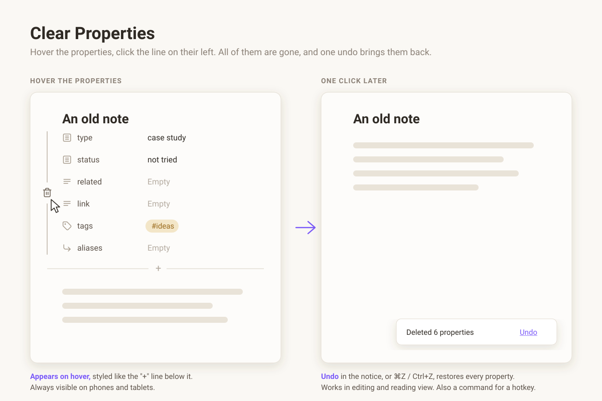

# Clear Properties

Cleaning up old notes often means getting rid of properties (YAML frontmatter)
you no longer use. Obsidian only lets you delete them one at a time, each with
its own menu.

Clear Properties adds a thin line to the left of a note's properties. Hover the
properties to see it, click the trash icon on it, and every property of the note
is deleted at once, together with the `---` lines around them.

## Features

- **One click, all properties.** The whole frontmatter block goes, along with
  the blank lines right after it, so the note starts with its first line of text.
- **Out of the way.** The line only shows up when you hover the properties, and
  it is drawn like the hairline of the "+ Add property" button, so it fits most
  themes.
- **Undoable.** A notice says how many properties were deleted and has an
  **Undo** link. In editing view, ⌘Z / Ctrl+Z works too.
- **Editing and reading view.** In reading view the note is saved first, then
  the properties are removed from the file.
- **Works on phones and tablets.** There is no hover on touch screens, so there
  the line is always visible. Tap it to delete.
- A command, **Clear Properties: Delete all properties of current note**, for a
  hotkey or the mobile toolbar.
- English and Chinese interface, following Obsidian's language.

## Use cases

- Strip leftover YAML from notes imported from other apps or old templates.
- Remove frontmatter before sharing or publishing a note.
- Clean up old notes one by one while you review them, on desktop or on your phone.

## Install

Search for **Clear Properties** in Settings → Community plugins, or copy
`main.js`, `manifest.json` and `styles.css` from the latest release into
`<vault>/.obsidian/plugins/clear-properties/`.

There are no settings.

## License

MIT
